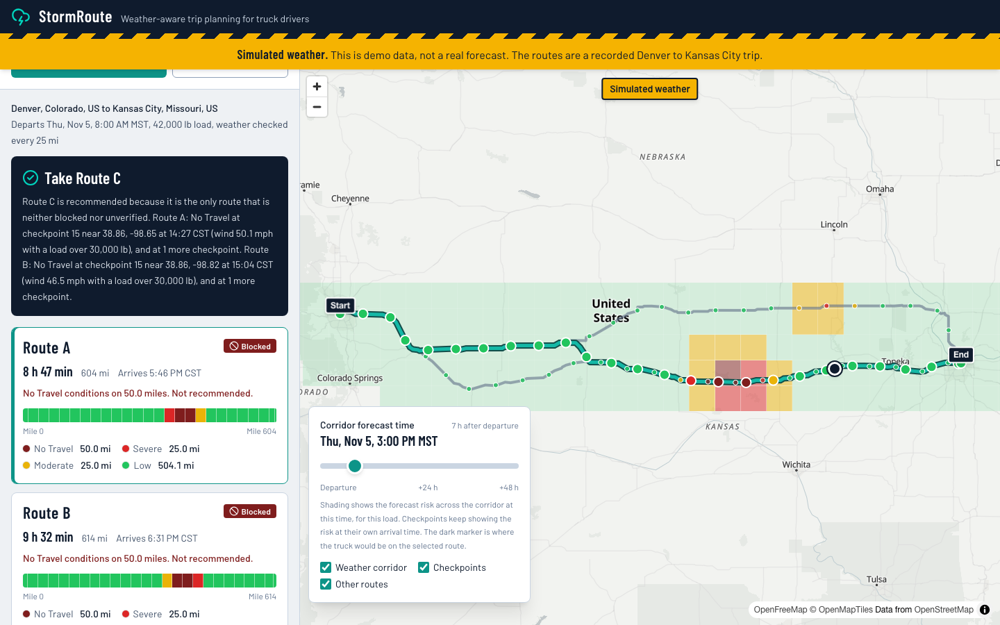

# StormRoute | Weather-Aware Trip Planning

A React + Django application that helps a truck driver choose the safer route. It asks a routing
service for up to three real routes, places a checkpoint every 10, 25 or 50 miles, looks up the
hourly forecast for each checkpoint at the time the truck is expected to get there, applies
Spotter's wind, rain, snow and load rules, and recommends a route in a fixed priority order.

Built for the Spotter Full Stack Developer take-home assessment by Oliver Leonor.



| | |
|---|---|
| Hosted application | Not deployed yet. See [Deployment](#deployment). |
| Backend health check | https://stormroute-api-navy.vercel.app/api/health/ (health endpoint only, from PR #1) |
| Walkthrough video | To be recorded. Script: [`docs/LOOM_SCRIPT.md`](./docs/LOOM_SCRIPT.md) |
| Specification and decisions | [`spec.md`](./spec.md) |
| Architecture | [`docs/ARCHITECTURE.md`](./docs/ARCHITECTURE.md) |
| Assumptions and limitations | [`docs/ASSUMPTIONS.md`](./docs/ASSUMPTIONS.md) |

## What it does

- **Trip form:** origin and destination (city and town search), departure date and time, load
  weight in pounds, and a checkpoint interval of 10, 25 or 50 miles.
- **Routes:** up to three genuine alternatives from the Valhalla routing service. If the service
  returns fewer, the app says so. It never invents a route.
- **Checkpoints and ETAs:** a checkpoint at every interval along each route, with an arrival time
  from the router's own per-maneuver driving times.
- **Weather at arrival:** the hourly forecast nearest to each checkpoint's arrival time, from
  Open-Meteo. Leaving later moves every arrival onto a later forecast hour.
- **Risk:** each checkpoint is Low, Moderate, High, Severe or No Travel, or Unknown when there is
  no usable forecast. Each mile of a route belongs to its nearest checkpoint.
- **Recommendation:** fewest Severe miles, then fewest High miles, then lowest average risk, then
  shortest duration. A route with any No Travel checkpoint is never recommended, and neither is a
  route whose weather could not be verified.
- **Map:** all routes, the selected one highlighted, checkpoints colored by risk. Click a route or
  a checkpoint, or use the risk ribbon on each route card with the keyboard.
- **Corridor heatmap:** the forecast risk around the routes for the next 48 hours, with a time
  slider. Moving the slider makes no network request.
- **Demo mode:** a recorded real routing response with scripted weather, clearly labeled, for
  showing the rules when real weather is calm.

## How risk is computed

A band written "X to below Y" includes X and excludes Y, so a value on a shared boundary belongs
to the more severe band. "Above" is strict.

| Level | Wind (mph, sustained) | Rain (in/h) | Snow (in/h) |
|---|---|---|---|
| Low | below 25 | below 0.10 | below 0.5 |
| Moderate | 25 to below 35 | 0.10 to below 0.25 | 0.5 to below 1.0 |
| High | 35 to below 45 | 0.25 to below 0.50 | 1.0 to below 2.0 |
| Severe | 45 to below 55 | 0.50 through 1.00 | 2.0 through 3.0 |
| No Travel | 55 and above | above 1.00 | above 3.0 |

Load rules, with strict comparisons:

1. Wind of 55 mph or more is No Travel for any load.
2. Wind of 45 to below 55 mph with a load over 30,000 lb is No Travel.
3. Wind of 35 to below 45 mph with a load over 40,000 lb is Severe.

A checkpoint's level is the highest of its wind (after the load rules), rain and snow levels.

- Rain rate is Open-Meteo's `rain + showers` for the hour. Snow rate is `snowfall` for the hour.
- Values are classified at the provider's precision. 25.41 mm of rain in an hour is 1.000394 in/h,
  which is above 1.00 and therefore No Travel. A displayed value keeps enough decimals to agree
  with its level.
- A missing measurement is never treated as zero. If an available measurement already proves
  No Travel, the checkpoint is No Travel. Otherwise it is Unknown, and the route is unverified.

The rules live in one pure module, [`backend/risk/classification.py`](./backend/risk/classification.py),
and are used for checkpoints and heatmap cells alike.

## How a route is recommended

1. Routes with a No Travel checkpoint (blocked) or an Unknown checkpoint (unverified) are set
   aside. They are shown, with the reason, but never recommended.
2. The remaining routes are sorted by Severe miles, then High miles, then average risk, then
   duration. There is no weighting. Miles are compared at 0.1 and average risk at 0.001.
3. The explanation names the first criterion that separated the winner from the runner-up and the
   difference in travel time, using the same numbers the response contains.
4. If no route remains, the answer is "No safe route is currently recommended." with the blocking
   conditions.

Risk mileage is the sum of the miles each checkpoint stands for. It is never the number of
checkpoints multiplied by the interval.

## Architecture

```text
Browser (React 19, TypeScript, Vite, Tailwind 4, TanStack Query, MapLibre GL)
   |  POST /api/routes/analyze/   GET /api/geocode/   GET /api/health/
   v
Django 6 + Django REST Framework (stateless: no database, no auth)
   |-- analysis/   request validation, orchestration, corridor heatmap
   |-- routing/    Valhalla client, polyline decoding, checkpoint sampling, ETA profile
   |-- weather/    Open-Meteo client, unit validation, geocoding, demo scenario
   |-- risk/       pure classification, aggregation and recommendation
   `-- common/     error types, TTL cache, outbound HTTP
```

The backend owns every rule and every provider call. The frontend renders the typed response.
Details are in [`docs/ARCHITECTURE.md`](./docs/ARCHITECTURE.md).

## Data providers

| Need | Provider | Why |
|---|---|---|
| Routing | Valhalla, public FOSSGIS server | Returned three distinct routes on all five test corridors with no key. OSRM's demo server returned one or two. |
| Weather | Open-Meteo forecast API | Hourly wind, rain, showers and snowfall, free, no key, units selectable and reported back. |
| Place search | Open-Meteo geocoding API | Free, no key, proxied by the backend. |
| Map tiles | OpenFreeMap | No key in the browser. |

No API key or paid service is used anywhere.

## Running locally

```bash
# Backend (Python 3.12 or newer)
cd backend
python3 -m venv .venv && . .venv/bin/activate
pip install -r requirements-dev.txt
python manage.py runserver 8000          # http://localhost:8000/api/health/

# Frontend (Node 24 via nvm), in a second terminal
cd frontend
nvm use && npm install
npm run dev                              # http://localhost:5173
```

Copy `.env.example` to `.env` at the repository root for backend settings and to `frontend/.env`
for the Vite variables. The defaults work without any changes.

Press **Run the demo trip** to see a result without calling the routing or weather services.

## API

| Endpoint | Purpose |
|---|---|
| `GET /api/health/` | Service status and provider names |
| `GET /api/geocode/?q=Denver&limit=5` | City and town search |
| `POST /api/routes/analyze/` | Routes, checkpoints, weather risk, recommendation and heatmap |

```bash
curl -s -X POST http://localhost:8000/api/routes/analyze/ \
  -H 'Content-Type: application/json' \
  -d '{
        "origin":      {"lat": 39.7392, "lon": -104.9903, "label": "Denver, Colorado, US"},
        "destination": {"lat": 39.0997, "lon": -94.5786,  "label": "Kansas City, Missouri, US"},
        "departure_time": "2026-11-06T08:00:00-07:00",
        "load_weight_lb": 42000,
        "checkpoint_interval_miles": 25
      }'
```

`departure_time` must carry a UTC offset and be between 1 hour ago and 14 days ahead. Add
`"mode": "fixture"` for the demo. Errors use one envelope, `{"error": {"code", "message", ...}}`,
with 400, 422, 429, 502 and 504 statuses. The full contract is in `spec.md` section 6.

## Tests

| Suite | Command | Size |
|---|---|---|
| Backend | `cd backend && pytest` | 384 tests, no network |
| Backend, live providers | `cd backend && pytest -m live -s` | 1 test, run by hand |
| Frontend | `cd frontend && npm test` | 136 tests |
| End to end | `cd frontend && npm run e2e` | 11 specs at 1280 px and 375 px |
| Lint and types | `ruff check .`, `npm run lint`, `npm run typecheck` | |

The risk rules are tested at every boundary (24.99 and 25 mph, 30,000 and 30,001 lb, 1.00 and
1.001 in/h, and so on). The end-to-end suite uses recorded responses of the real backend, so it
never calls the public providers.

## Deployment

Both parts are built for Vercel's free Hobby plan: the Django backend as a Python function and
the frontend as a static Vite build. The steps, the environment variables and a script that
verifies a deployment end to end are in [`docs/DEPLOYMENT.md`](./docs/DEPLOYMENT.md). Results are
recorded in [`docs/VERIFICATION.md`](./docs/VERIFICATION.md).

## Assumptions and limitations

- Routes are standard driving routes. Truck restrictions such as bridge weight limits, low
  clearances and hazmat rules are not applied.
- Load weight is cargo weight. It is used only for the weather rules.
- Arrival times assume continuous driving at the router's speeds. Rest breaks, fuelling and live
  traffic are not modelled.
- The forecast hour used is the one nearest to the arrival time, so it can be up to 30 minutes
  away from it. Wind is the sustained wind, not gusts.
- The public routing and weather services have no availability guarantee. A failure is reported
  with a message the driver can act on.
- Caches and rate limits live in process memory, so on serverless hosting they apply per instance.

The full list is in [`docs/ASSUMPTIONS.md`](./docs/ASSUMPTIONS.md).

## AI assistance

This project was built with AI assistance. Claude Code wrote the code, tests and documentation
under my direction, one pull request at a time against `spec.md`. Each pull request was reviewed
with OpenAI Codex and by me before I merged it, and the findings and fixes are recorded in
`spec.md` section 14. Scope, provider choices and acceptance decisions were mine.

## Time

Active working time is logged per session in `spec.md` section 18, against Spotter's limit of 16
hours.

## Attribution

Routing by [Valhalla](https://github.com/valhalla/valhalla) on the FOSSGIS e.V. server. Map data ©
[OpenStreetMap contributors](https://www.openstreetmap.org/copyright). Weather data by
[Open-Meteo.com](https://open-meteo.com/) (CC BY 4.0). Map tiles by
[OpenFreeMap](https://openfreemap.org/).
